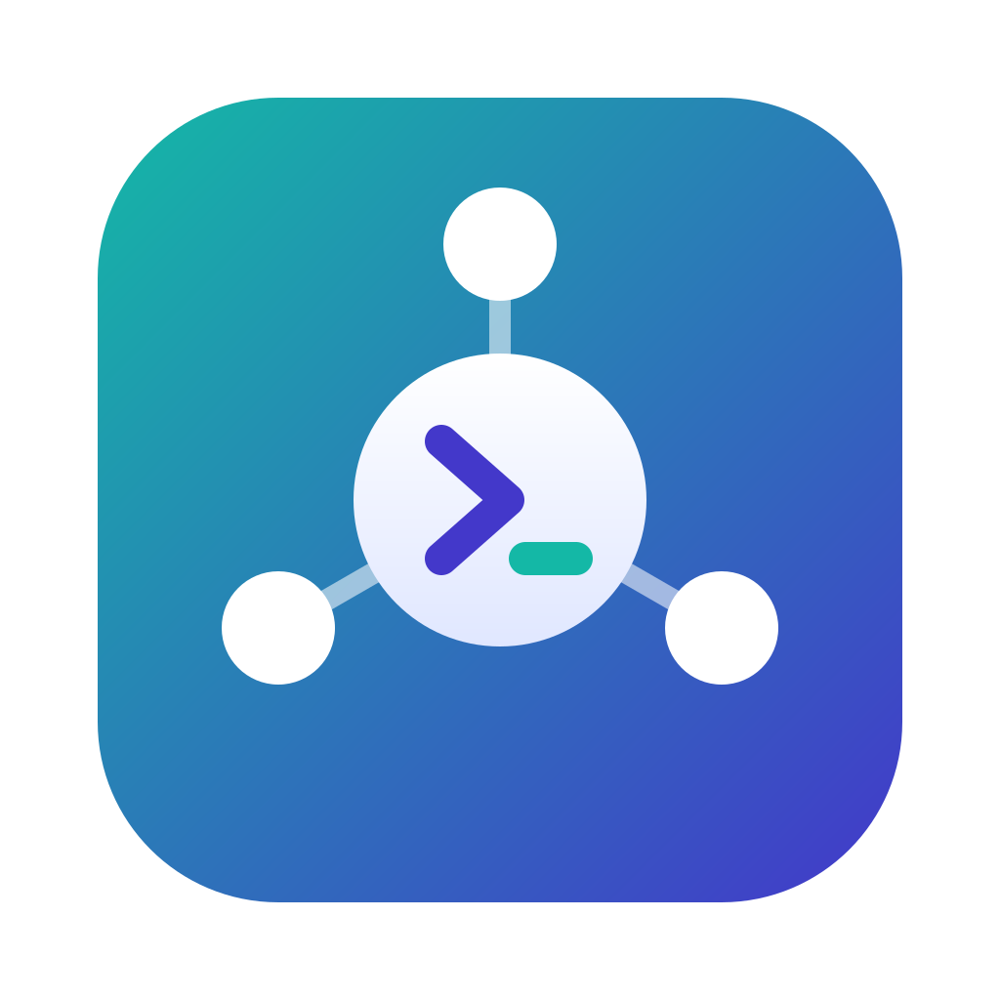

# Workhub 2

<p align="center"></p>

A cross-platform desktop app (Electron) to run and supervise coding agents - Claude Code, Codex,
Kiro, OpenCode, Gemini CLI or any other CLI - next to the pull requests, tickets, chat threads and
environment health around each task. Agents declare their capabilities and the UI shows only what
each one supports. Nothing personal or company-specific is in the code: every connection, profile
and account is configuration loaded at runtime.

Status: pre-release (`2.0.0-alpha.1`). macOS is the only platform exercised so far; Windows and
Linux installers are built by CI and untested. See [PLAN.md](PLAN.md) for the scope and the
current status.

## Features

**Sessions**
- Run Claude Code (native Agent SDK adapter, or over ACP), Codex, Kiro, OpenCode and Gemini CLI
  (ACP), or any CLI in a PTY. Each session switches between **App** (chat), **Terminal** (the
  agent's own TUI, same conversation) and **Shell** (a shell in the session folder).
- Composer queue (type while the agent works), pasted images, rename, detach a session into its
  own window, reopen the sessions that were open at quit, resume from History.
- Sidebar with folders, groups (drag to reorder), sub-agents, profile colors and attention flags
  (replied, needs an answer, failed); optional OS notifications and app badge.
- Read replies aloud with the OS voices, per session.

**Accounts and usage**
- Several accounts per agent (a Claude account is a config folder), per-profile agent order, and
  failover or hand-off to another account or agent when one runs out.
- Usage cards for Claude (5 h / weekly windows), Kiro (credits) and Codex (rate limits), usage
  ceilings and alerts, API-key spend, and a usage budget per session.

**Monitor**
- Per session: context window, tokens (per request too), active time, activity, MCP servers
  (status, reconnect and toggle for Claude), sub-agents, local changes per touched repo, and the
  pull requests, tickets and Slack threads the session worked on.
- Home shows what needs you, tickets in progress, plan usage and token spend per profile and folder.

**Work around the agent** (the last three are optional modules, off by default, enabled per profile)
- **Pull requests** (GitHub through `gh`, GitLab through `glab`): list, PR window, review state, CI,
  Slack tab, close with comment.
- **Tickets**: Jira Cloud and Linear.
- **Slack** (module): follows channels and threads through a Claude account's Slack connector,
  read-only; wakes the session that owns a thread. No Slack app and no token.
- **Automations** (module): send a prompt to a dedicated session on a Slack event or a schedule.
- **Health** (module): Elastic APM and Kibana - errors, pods, slow endpoints, alerts - with
  "investigate with an agent".
- **Local diff review**: review a branch or the uncommitted changes, comment on lines and send the
  comments to the agent. **AI review**: a reviewer agent checks a branch before the PR. A file
  viewer window opens files the agent read or edited.

**App**
- Profiles with folders, a default folder and per-folder options; a settings modal with a save
  bar; menu bar / tray popover; setup check and welcome windows; Workhub 1 import (macOS).
- Light/dark and 485 terminal color schemes; English and Spanish.
- Flows from Workhub 1 are intentionally not ported.

## Requirements

- macOS, Windows or Linux (only macOS is tested so far)
- To run from source: Node.js 22 and npm 10 (Windows needs no build tools; Linux needs python3, make
  and a C++ compiler; see CONTRIBUTING.md)
- The agents you want to run, on your PATH (for example `kiro-cli`, `opencode`, `gemini`); Codex
  runs through `npx`. An agent that is not installed shows as such in New session, with how to
  install it. The Claude Agent SDK and its `claude` binary ship inside the app, so Claude sessions
  need no separate Claude Code install (sign in with a Claude account in the app's Setup check).
- `gh` (and `glab` for GitLab) signed in, for pull requests.

## Install

Download the installer for your OS from the
[Releases](https://github.com/SoldierIced/workhub/releases) page. The `release` workflow builds
them for macOS (arm64 `.dmg` and `.zip`), Windows (x64 NSIS `.exe`) and Linux (x64 `.AppImage` and
`.deb`). The app is called **Workhub 2** and has its own app id and data folder, so it can run next
to Workhub 1. The builds are **not signed with a paid certificate**, so each OS asks for one extra
step on the first launch. Every artifact has a `.sha256` file to check the download.

**macOS**: open the `.dmg` and drag Workhub 2 to Applications (or unzip the `.zip`). The app is
signed ad hoc and not notarized, so Gatekeeper blocks the first launch: open the app once, then go
to System Settings > Privacy & Security, scroll to Security and click **Open Anyway**. Or run
`xattr -dr com.apple.quarantine "/Applications/Workhub 2.app"` and open it again.

**Windows**: run the `.exe`. SmartScreen shows "Windows protected your PC": click **More info**,
then **Run anyway**. The installer lets you pick the folder and installs per user.

**Linux**: `chmod +x Workhub-2-*-linux-x64.AppImage && ./Workhub-2-*-linux-x64.AppImage`, or
`sudo apt install ./Workhub-2-*-linux-x64.deb`.

**macOS from source**: `scripts/install-mac.sh [--dry-run]` builds the app and installs it to
`/Applications` (named `WORKHUB_BUNDLE_NAME`, default `Workhub`). It refuses to replace a bundle
that is another app, and quits and reopens only Workhub 2 (`WORKHUB_KEEP_RUNNING=1` swaps the
bundle without quitting).

### Updates

Settings > General > Updates has a **Check for updates** switch, off by default: nothing contacts
GitHub unless you turn it on or press **Check now**. On Windows and Linux AppImage the app can
download and install the new version. On macOS an unsigned app cannot replace itself, so it only
announces the new version and opens the release page.

## First run

1. Open **Settings** (⌘/Ctrl+,) or the **Setup check** from the Help menu. It checks Node, `gh`,
   Claude sign-ins, Jira, Slack, Health and usage, with a fix button per item.
2. **Accounts**: add the agent accounts you use (a Claude account is a config folder; Kiro and
   Codex use their own CLI sign-in).
3. **Profiles**: create a profile, give it folders (and a default folder, where New session starts
   the preferred agent), accounts and connections, and turn on the optional modules you want
   (Slack, Automations, Health).
4. **Connections / Trackers / Health**: add Jira or Linear, GitHub or GitLab, and Elastic
   environments. Secrets typed here (API tokens) go to `secrets.json`, encrypted with Electron
   `safeStorage` (macOS Keychain, Windows DPAPI, Linux libsecret/kwallet). If OS encryption is
   unavailable Workhub refuses to store a secret.
5. Optional: **Import from Workhub 1** (Settings > General, macOS, shown only when Workhub 1
   settings exist) previews and imports profiles, folders, accounts, connections and more. It never
   writes to Workhub 1 and copies no secrets; connections that need one are marked "re-enter".

## Using it

- **Navigation**: Home ⌘/Ctrl+1, Pull requests 2, Tickets 3, Slack 4, Automations 5, History 6,
  Health 8, Sessions 0; New session ⌘/Ctrl+T. Screens tied to a module show only when the active
  profile enables it.
- **Sessions**: the sidebar groups sessions by folder and group. A session is flagged when it
  finishes a turn, asks for a permission or fails while not on screen. The effective permission
  mode of each session is shown in its header.
- **Monitor** reads the agent's own transcript every few seconds. History lists the sessions of
  every configured account and agent, resumable in the app or the terminal (only Claude sessions
  can be resumed so far).
- **Plan usage**: Kiro credits are read by default; reading Claude plan usage from Anthropic's
  undocumented usage endpoint, and Codex usage, are opt-in settings (Settings > Usage).
- **Slack**: reads the channels set in Settings > Slack on a schedule through your Claude
  account's Slack connector (queries that post or change anything are refused). The optional
  tracking hook records the Slack messages a Claude session sends so Workhub follows that thread;
  it edits the account's `settings.json` only when you click Install (a `.bak` copy is kept), and
  Remove takes out only its own entry.
- **Automations** fire at most once per Slack event, even across restarts (ledger in
  `automations-state.json`).
- **AI review**: on by default per profile. When a dev session stays idle on a branch with commits
  ahead of its base, a reviewer agent reviews it on a read-only checkout under the data folder and
  sends findings to the dev session, for up to 3 rounds; it pauses for you when it needs a
  decision.

## Development

```sh
npm ci               # postinstall downloads the Electron binary and prepares node-pty for it
npm run dev          # the app in development mode ("Workhub 2 Dev")
npm run typecheck    # tsc on every package
npm test             # Vitest: core, adapters and app
npm run build        # electron-vite build of the app (packages/app/out)
```

To run the built app: `cd packages/app && npx electron .`. See [CONTRIBUTING.md](CONTRIBUTING.md).

Data folder, in order of precedence: `WORKHUB_DATA_DIR`; `packages/app/.dev-data/` in a development
run (git-ignored); the app's `userData` folder in a packaged build. Use `WORKHUB_DATA_DIR` to keep a
test run away from real data.

Other environment variables, all for development, demos and smoke runs:

| Variable | Effect |
|---|---|
| `WORKHUB_DEMO_TICKETS=1`, `WORKHUB_DEMO_CODEHOST=1`, `WORKHUB_DEMO_SLACK=1`, `WORKHUB_DEMO_HEALTH=1`, `WORKHUB_DEMO_USAGE=1` | Serve synthetic tickets, pull requests, Slack channels, Health data or usage instead of a real service |
| `WORKHUB_KIRO_DIR` | Read Kiro's files from another folder |
| `WORKHUB_NOTIFICATION_LOG`, `WORKHUB_TRAY_LOG` | Write notifications / the tray menu to a file, for smoke runs |
| `WORKHUB_TRAY_POPOVER_PIN=1` | Keep the tray popover open (screenshots) |

Smoke tests: start the app with `--remote-debugging-port=9222` and drive it over CDP with
`packages/app/scripts/drive.mjs`. To exercise automations without a model, use
`packages/app/scripts/demo-agent.mjs` as a custom ACP agent.

### Build installers

```sh
npm run dist          # installers for the current OS, into dist/
npm run dist:mac      # dmg + zip, arm64 (needs an Apple Silicon Mac)
npm run dist:win      # NSIS installer, x64 (run on Windows)
npm run dist:linux    # AppImage + deb, x64 (run on Linux)
npm run icons         # regenerate packages/app/build/icon.* from logo/workhub-logo.svg
```

`node-pty` is native, so each OS builds its own installers. The build stages the Claude bridge
(`scripts/stage-bridge.mjs`) and ships it in the app's resources. The macOS build is signed with
`WORKHUB_SIGN_IDENTITY`, else the first "Apple Development" identity in the keychain, else ad hoc;
it is never notarized. The product name, app id and release repository live in
`scripts/brand.mjs` only.

### Release process

The version is the root `package.json`'s (`packages/app/package.json` must match). A version with a
suffix (`2.0.0-alpha.1`) is published as a pre-release.

1. Set the version in both `package.json` files, commit, push.
2. Push a tag: `git tag v2.0.0-alpha.1 && git push origin v2.0.0-alpha.1`. The `release` workflow
   checks the tag against the version, builds the three installers and attaches them, with
   checksums and `latest*.yml` update metadata, to a **draft** release. Review and publish it.
3. Or release the macOS build from your machine: `scripts/release.sh --dry-run`, then `--publish`.

The `ci` workflow runs install, typecheck, tests and build on macOS, Windows and Linux for every
push to `main` and every pull request. Signing and notarization are a later step.

## Project structure

```
packages/
  core/       Domain models, ports, use cases, config schema. Pure TypeScript, depends only on zod.
  adapters/   Port implementations on Node/Electron:
                config-json, secrets-electron, pr-events-json   storage (JSON files, safeStorage)
                agent-claude-native   Claude through the Agent SDK bridge (MCP, hooks, permissions, usage)
                agent-acp             Agent Client Protocol: Kiro, OpenCode, Codex, Gemini CLI, Claude
                agent-terminal        any CLI over a PTY (node-pty)
                transcript-claude / -kiro / -opencode / -codex   monitor and history readers
                codehost-github / -gitlab   pull requests through gh / glab
                tracker-jira / -linear / -demo   tickets
                chat-slack, health-elastic, git-review, token-spend, workhub1-import
  app/        Electron shell: main process, preload bridge, React renderer (Tailwind + Radix, en/es)
scripts/      Build, release, icons and install scripts
spike/        P0 spike, historical (not part of the workspaces)
```

Dependencies point inward: `app` uses `adapters` and `core`; `adapters` implement the ports in
`core`. Workspace packages ship TypeScript source and the app bundles them with electron-vite, so
there is no separate build step for `core` or `adapters`.

## Privacy

No telemetry. Workhub makes network calls only to services you configure (your code host, tracker,
Elastic, agents) and to GitHub when you turn on update checks. Configuration stays on your machine;
`config.json` holds only `secretRef` keys, never secrets. Agents run with their own configuration
(MCP servers, hooks, permission defaults). See [SECURITY.md](SECURITY.md) for what is stored where.

## Contributing

Issues and pull requests are welcome; read [CONTRIBUTING.md](CONTRIBUTING.md) first. Report security
problems privately as described in [SECURITY.md](SECURITY.md).

## License

[MIT](LICENSE). Third-party material is listed in [NOTICE](NOTICE).
