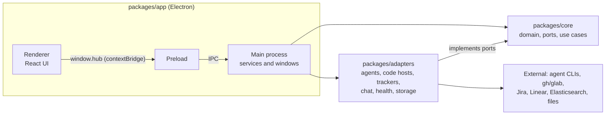

# Architecture

For contributors. For setup and pull request rules see [CONTRIBUTING.md](../CONTRIBUTING.md); the
original scope and decisions are in [PLAN.md](../PLAN.md).

## Packages

An npm workspace with five packages. Dependencies point inward.

| Package | Role | May depend on |
|---|---|---|
| `packages/core` | Domain models, ports (interfaces), use cases, the config schema. Pure TypeScript; its only runtime dependency is `zod`. No Electron or Node APIs. | nothing in the repo |
| `packages/protocol` | The Workhub Remote wire protocol: device identities, pairing, the end-to-end encrypted channel and its message schemas. Pure TypeScript that runs in Node and the browser (`zod`, `@noble/curves`, `@noble/ciphers`, `@noble/hashes`). | nothing in the repo |
| `packages/relay` | The relay a desktop and its paired devices meet through: WebSocket rooms, presence, Web Push for devices that are offline, and the web client's files. It forwards bodies it cannot read. Bundled with esbuild into one file and shipped as a container image (`packages/relay/Dockerfile`). | `protocol` |
| `packages/adapters` | Implementations of the ports on Node and Electron: agents, code hosts, trackers, chat, health, calendars, storage, transcript readers. | `core` |
| `packages/app` | The Electron shell: main process, preload bridge and the React renderer (Tailwind and Radix, English and Spanish), plus the phone app for paired devices (`src/web/`: its own Vite entry and service worker, reusing the renderer's store, components and i18n over `window.hub`). | `core`, `adapters`, `protocol` |

Workspace packages ship TypeScript source and the app bundles them with electron-vite, so there is
no separate build step for `core`, `protocol` or `adapters`; only `relay` bundles itself for its image. `scripts/` holds build, release, icon and install
scripts; `spike/` is a historical spike and is not part of the workspaces.

## Ports and adapters (hexagonal)

`core` declares what the app needs; `adapters` supply it. Add behavior as a port in `core` plus an
adapter, not by reaching into a service from the UI.

| Port (in `core`) | Adapters |
|---|---|
| `AgentRuntime` | `agent-claude-native`, `agent-acp`, `agent-terminal` |
| Transcript readers (fill the common monitor model) | `transcript-claude`, `-kiro`, `-opencode`, `-codex` |
| Code host | `codehost-github` (`gh`), `codehost-gitlab` (`glab`) |
| Ticket tracker (capabilities: sprints, transitions, comments, assign, and the optional `search` and `create` that Plan uses) | `tracker-jira`, `tracker-linear`, `tracker-github` (GitHub Issues through `gh`), `tracker-demo` |
| Chat source | `chat-slack` (through a Claude account's Slack connector) |
| Health provider | `health-elastic` |
| Calendar source (`CalendarSource`; ICS parsing, recurrence and rules are pure code in `core/calendar`) | `calendar-ics` (private ICS address over https, 60 s timeout, 20 MB cap; also the demo source) |
| `MetricSource` (daily samples for metric alerts) | Health's own read (`HealthMetricSource` in the main process), synthetic history in the Health demo |
| Config and secrets | `config-json`, `secrets-electron` (Electron `safeStorage`) |
| Other | `pr-events-json`, `git-review`, `git-worktree`, `token-spend` |

`git-review` reads repositories (`GitReview`, `LocalChanges`) and never writes to them, with one
exception kept in its own class: `LocalReverter` (`git-review/revert.ts`) reverts uncommitted
changes from the local review window (`localReview:revert`, not in the remote allowlist). The
renderer sends a file, a hunk index, line indexes and the digest of the file's raw diff the load
gave it (`LocalReviewFile.digest`, uncommitted scope only), never patch text. Main reads
`git diff HEAD` again and answers `changed` when the digest differs; a hunk or lines are undone
with a patch built from the raw diff by `buildRevertPatch` (pure, `core/local-review/revert.ts`)
and `git apply -R`, in the index too when the change is staged; a whole file with `git restore
--source=HEAD --staged --worktree`. A path HEAD does not have (untracked, new, a rename's new name)
goes to the system trash (`shell.trashItem`, injected) instead of being deleted.
`LocalReviewService.revert` checks the session, the scope and that the repo and path belong to
the session's loaded review, and runs reverts in one repo one at a time.

Trackers declare optional capabilities too. `searchByQuery` (Jira: JQL through
`/rest/api/3/search/jql`, paged up to a cap; Linear: a project, or a team key and a label) counts
Plan's milestones, and `createIssue` (Jira: `POST /rest/api/3/issue` with an ADF description;
Linear: `issueCreate` in a team found by key) turns approved inbox items into issues. Both take a
generic priority from 1 (highest) to 4 that each adapter maps to its own scale. `readTickets` reads
tickets by key in one request (Jira: a `key in (…)` JQL search, key by key when Jira refuses the
batch for an unknown key; Linear: one issues query filtered by team key and number): Plan's
service reads the tickets of milestone pieces and of inbox items that follow a ticket with it, in
the same 30-minute cycle as the milestone counts, keeps their state in the database (`planner-state`) and
marks an item done when its ticket turns done. A tracker without these hides those features (a
ticket it cannot read stays in an unknown state, never counted as done).

Agents declare their capabilities (app mode, transcript, usage, plan usage, history, hooks, models,
MCP status and control, sub-agents, permission requests, image input, mid-turn input). The UI
derives what to show from them, so adding an agent does not mean touching the screens.

The session monitor is independent of the transport: one common model per session, filled by one
transcript reader per agent. Each reader works from the agent's own files, which are internal and
undocumented, so readers ship with fixture tests and fail soft: missing data hides the field and
never breaks the session.

## IPC and security model

- Every window has `contextIsolation: true`, `nodeIntegration: false` and `sandbox: true`. The
  renderer has no Node. The only bridge is the preload script, which exposes one object,
  `window.hub`, with `contextBridge.exposeInMainWorld`. Its shape is typed in
  `packages/app/src/shared`, shared by main, preload and renderer. The object itself is built by
  `shared/hub-client.ts` over a `HubTransport` (invoke, send, subscribe): the preload passes
  Electron IPC; the web client for a paired phone passes a WebSocket to the desktop. Channel names
  live in that one file.
- Main registers IPC handlers through three wrappers. `guardIpc` checks that each message comes from
  the app's own renderer (the built `index.html`, or the dev server origin in a dev run); anything
  else is rejected. `timeIpc` times each handler and logs slow or failing ones, never their
  arguments. `recordIpc` (`main/remote/`) keeps every handler by channel so a paired device can
  reach the same code without Electron IPC.
- The main process's composition root is `main/index.ts`: it builds the services and wires them to
  a few modules. `windows.ts` creates the main and secondary windows and installs the navigation and
  permission guards; `broadcast.ts` is the one way events go to the windows and paired devices;
  the IPC handlers live in one `register…Ipc` function per domain (`main/ipc/<domain>.ts` and the
  services' own registrars), all called from `registerIpc` in `index.ts`; `tray-controller.ts`
  and `notifications.ts` hold the tray's state and where a notification click leads; and
  `lifecycle.ts` lists the order services start in and stop in at quit.
- Remote access (`main/remote/dispatcher.ts`): a paired device calls `hub` methods and gets main's
  events over a transport of its own. The `RemoteHub` only routes channels in its allowlist
  (`main/remote/allowlist.ts`), each tied to a capability the user granted the device (sessions,
  pull requests, automations, health). A call channel is listed only while the phone's web client
  calls it (`test/remote-allowlist.test.ts` reads the client's sources), so a stolen device
  identity reaches no more than the phone app offers. Automations reach a device as short rows (`remote:automations`, paged; `automations:get`, whose snapshot holds every prompt, stays closed), with run now (only for one that is on), stop and turn off; a device can never turn one on (an agent may have edited it; `main/remote/automations.ts`). Nothing that opens a dialog or a window on
  the desktop, reads or writes a path the device names, touches settings or secrets, or tests a
  connection is listed. A new session may only start in a folder the profile lists, and never in
  a mode that skips permissions: a start with no mode is resolved to the mode it would really use,
  and when that skips permissions it runs in the agent's safest attended mode, or is refused. Handlers that answer their
  sender (`sessions:promptStarted`) see the device as a sender of its own, with an id no window
  can have. The config snapshot reaches a device without the data folder path.
  Every answer must fit one relay frame (520 KB): long lists a device reads page by page
  (`remote:sessions`, `remote:pullRequests` per list, each `{ limit, cursor }` → `{ items, nextCursor, total }`,
  `main/remote/paging.ts`), on top of the same handler and redaction as the unpaged call; a
  session too large for a page on its own goes as a stub (id, label, state). The desktop names
  what it understands in its `ready` (`features`: `away`, `paging`, `activity`, `changes`); a phone asks for
  pages only when `paging` is named, so an older desktop and an older phone keep working.
  What a session changed reaches a device through the desktop's own local review
  (`LocalReviewService.load`, every change of the session's repos; `main/remote/changes.ts`):
  `remote:changes` pages the changed files (repository key, path, status, line counts; never a
  repository root), `remote:diff` pages one file's hunks cut into pieces of about 48 KB with lines
  over 2,000 characters cut, so each page stays under `PAGE_BYTES`. The device names a file only by
  the repository key and path the list sent, and gets a diff only for a file that list holds (read
  again once when the cached one does not have it); dotfiles and key-like names are listed without
  their content, as `remote:file` refuses them. A first page reads git again; later pages and diffs
  answer from that read for a minute. `remote:review` gives the session's "Review before PR" and
  "Review with another agent" loop trimmed to a frame, with the decisions the desktop panel offers
  while each waits for the person: Continue or Stop for a paused review, the finding pick (with a
  note) or Stop for a loop waiting for approval. `remote:reviewDecide` takes one of those for the
  session the device names, never a review or loop id, and only while it is offered
  (`main/remote/review.ts`). The phone asks for these only when `changes` is named.
- Pairing (`protocol/src/pairing.ts`, `main/remote/service.ts`, `web/remote-client.ts`): the QR's
  offer carries `pv` (pairing version, 2). A version-2 request makes the desktop send, boxed to the
  device, a challenge: a fresh nonce signed over both fingerprints and the offer's expiry. Both
  ends derive the pairing code, HMAC-SHA256 keyed with the offer's secret over both fingerprints
  and the nonce, reduced to six digits; the phone shows it and the person types it on the desktop
  (`acceptPairing(deviceId, capabilities, code)`). The nonce is chosen after the device's identity
  is fixed and is signed, so neither a QR viewer nor the relay can grind an identity whose code
  matches. The offer remembers the first device that answered: another device cancels it, as does
  a wrong code, and `RemoteStatusView.alert` says which. Versions: a phone that sees no `pv`
  reports `desktop-outdated` instead of answering; an older phone ignores `pv`, answers with a
  version-1 request, and the desktop, once its proof holds, shows `device-outdated` (update the
  phone) and keeps the offer open for it.
  Sub-agents and background tasks leave the desktop without their model, tokens or cost and with
  their text cut, both in live `session:event` monitor updates and in `remote:activity` (one
  session, or a list after a reconnect; `main/remote/activity.ts`); a waiting permission
  request's title and detail are cut too.
- Answering from a notification (`main/remote/permission-tickets.ts`, `web/notification-answer.ts`,
  `web/sw.ts`): a `needsAnswer` push to a device whose session waits on exactly one request that
  has a reject option and no questions carries an `ask` (session, request id, offered answers, a
  random ticket kept in memory for ten minutes for that device and request), signed by the desktop
  apart from the payload (`signPushAsk`) so a phone that ignores it still verifies the rest. The
  only answer offered is `deny`: `PendingPermission` does not mark dangerous requests, so Allow
  stays in the app. The service worker shows the answers as notification actions where
  `Notification.maxActions` is above 0; a tap on one opens its own relay connection with the
  device identity (no channel: a handshake would replace the page's live link), sends one
  `permission-answer` box sealed to the desktop and signed by the device, waits for the sealed
  `permission-answered` reply naming the ticket, and closes. The desktop opens boxes from paired
  devices outside pairing only for this; it checks the signature, the answer's age, that the ticket
  is the device's, unused and unexpired, names the same request and offers that answer, and that
  the request still waits, then sends `sessions:permission` through `RemoteHub.answerPermission`
  (the same allowlist entry, capability and budget as the chat's buttons). A ticket is used by the
  first answer that names it. The page mirrors each desktop's relay and the phone's language to
  IndexedDB for the worker.
- Windows stay on the app's renderer: navigations and redirects away from it are refused (web links
  go to the default browser through the link service instead), `window.open` is denied and
  `<webview>` never attaches. This keeps a window that rendered untrusted Markdown (a pull request,
  a ticket) from becoming a remote page that still holds `window.hub`.
- Secondary windows load the same renderer bundle and are routed by the URL hash
  (`renderer/main.tsx`): a pull request (`#pr?…`), a ticket (`#/ticket?…`), a session or
  sub-agent, a local review, the file viewer, a flow map, and a Plan inbox item or milestone
  (`#plan-item?profile=…&kind=inbox|milestone&id=…`, `&edit=1` for its edit form, or
  `#plan-item?profile=…&kind=milestone&new=1` for a new milestone; built and read by
  `shared/plan-item-window.ts`). Main keeps one window per ticket, flow map or Plan item (an item's
  view and edit form share it; a profile has one new-milestone window) and focuses it when it is
  asked for again; asking to edit an item whose window is open sends it `planner:edit`. Plan
  changes (`planner:changed`) go to every window, so an item's window stays live.
- Settings is a window of its own too (`#settings?section=<id>`, `main/settings-window.ts`): one at
  a time; asking for it again focuses it and sends it `settings:navigate`, which goes through the
  unsaved-drafts guard. Its renderer reports whether drafts are unsaved, so the window's close
  button asks first. Every config write tells every window (`config:changed`, from a wrapper around
  the config store in `main/config-broadcast.ts`), so a change made there shows in the main window.
- Web permissions (camera, microphone, geolocation, notifications and so on) are denied by default;
  only sanitized clipboard writes from the app's own renderer are allowed.
- Secrets are never in `config.json`, only `secretRef` keys that point into `secrets.json`, which is
  encrypted with `safeStorage`. Workhub refuses to store a secret when OS encryption is
  unavailable. GitHub and GitLab access reuses the `gh` and `glab` sign-ins; Slack goes through a
  Claude account's connector. See [SECURITY.md](../SECURITY.md).
- The local control endpoint (`control-server.ts`) is HTTP. On macOS and Linux it listens on a Unix
  socket in the data folder (mode `0600`) and sessions get `WORKHUB_SOCKET`. On Windows it listens
  on a loopback HTTP port (127.0.0.1, random port) guarded by a per-launch token; sessions get
  `WORKHUB_URL` and `WORKHUB_TOKEN`, and requests send `Authorization: Bearer $WORKHUB_TOKEN`. Either
  way only the user's own processes reach it, which says nothing about which session is calling, so
  every session also gets `WORKHUB_SESSION` and its own token, `WORKHUB_SESSION_TOKEN`
  (`control-auth.ts`: 32 random bytes minted when the session starts, kept only as a hash in
  memory, revoked when the session is removed, never logged). Requests send it as
  `X-Workhub-Token` (on Windows on top of the launch token). A request with a session token acts as
  that session: a `session` it names in the query or body must be its own (else 403), the session
  is filled in where it is left out, a `profile` it names is ignored (a session without a profile
  falls to the one owning its `cwd`, then the active one), and a read-only (reviewer) session gets
  403 on every change (anything but `GET` and `POST /v1/analytics/query`). A token of a removed
  session, or of one no longer listed, answers 401. Without a token only `GET` of `/v1/plan/today`,
  `/v1/inbox`, `/v1/milestones`, `/v1/people` and `/v1/automations` are answered, for the active
  profile and without `session`, `profile` or `cwd`, with a warning in the log; every change,
  History and analytics answer 401. That keeps a `curl` the user types in their own terminal
  working for reads while no process can write as, or read the plan of, a session it is not.
  Reviewer sessions are started with the variables empty (`NO_CONTROL_ENV`), so they get no token today; the read-only rule holds for any token a read-only session holds. Bodies are capped at 256 KB and
  checked field by field. Endpoints: `POST /v1/sessions/:id/review` (open the human review),
  `POST /v1/flow-maps`, and Plan's (`plan-control.ts`): `GET /v1/plan/today`, `GET` and `POST
  /v1/inbox`, `PATCH /v1/inbox/:id` (local moves and fields, and linking an existing ticket:
  approving an item to the tracker stays a human action in the UI), `GET /v1/milestones` and `GET /v1/people` (no notes), and the
  agent milestone changes `POST /v1/milestones`, `PATCH /v1/milestones/:id` and `DELETE
  /v1/milestones/:id`. With the profile's `agentMilestones: ask` (the default) they answer 202 with
  `pending: true` and wait as proposals on the Milestones tab; with `allow` they answer 200 with
  `applied: true`. Changes go through the same services as the UI, which push change events to open windows. Agents learn
  them from the skills in `skills/` (`workhub-flow-map`, `workhub-plan`, `workhub-automations`, `workhub-analytics`, `workhub-sessions`, `workhub-review`).
- Automations and History for agents (`automation-control.ts`): `GET /v1/automations`, `POST
  /v1/automations` and `PATCH /v1/automations/:id` save through the same service as the
  Automations screen, but always leave the automation off (`enabled: true` is refused), so an agent
  cannot start unattended runs on its own; there is no delete. `GET /v1/history` and `GET
  /v1/history/:agent/:session` read the History listing and a transcript, capped, without tool output;
  `q` searches the History index and adds `snippet` fields (see below).
- Analytics for agents (`analytics-control.ts`), all read-only, open to reviewer sessions too and
  not scoped to the caller's profile (like History): `GET /v1/analytics/schema` (tables, columns,
  how to query, examples), `POST /v1/analytics/query` (`{sql, params, limit}` → `{columns, rows,
  rowCount, truncated, timedOut, elapsedMs}`) and `GET /v1/analytics/report?kind=spend_by_project|
  spend_by_ticket|spend_by_tag|spend_by_agent|weekly` (`spendGroups`/`spendSeries`/`weeklySummary`
  over the usage database; the caller's profile by default; every answer carries `tokens`, input +
  output + cache writes as on Home and Usage). A query passes `checkReadOnlySql`
  (`sqlite-store/read-query.ts`: a tokenizer that reads strings, names, comments, numbers and
  parameters as SQLite does, then refuses anything but one `SELECT`/`WITH`, write, schema and
  transaction keywords, `PRAGMA`/`ATTACH`, file, extension and blob functions, and the tables off
  `ANALYTICS_TABLES`, named as a word, a quoted name or a single-quoted string; `turn_files`,
  `history_index` and `kv_state` are off it), then runs in a utility process (`analytics-worker.ts`, started by
  `analytics-queries.ts`, one query at a time) on a connection opened read-only with `PRAGMA
  query_only = 1` and an SQLite authorizer (Electron's Node has `setAuthorizer`; without it the
  worker reports so and every query is refused with 503 "read-only guard unavailable") that denies everything but reads of tables off the denied lists, the allowed functions
  and recursive CTEs. A query that runs past 5 seconds gets the process killed (`timedOut`, no
  rows) and the next one starts a new process, so no query can freeze the app. Values are bound
  only; at most 2000 rows. Each query's text and outcome (not its values) is logged, cut to 300
  characters. Not offered to paired devices. The Usage and reports screen's queries run in a second
  process of the same worker (see `workhub.db (usage data)` below); the `report` endpoint above still
  runs on the main process.
- Sessions for agents (`session-control.ts`), session token required, scoped to the caller's
  profile (another profile's session answers 404): `GET /v1/sessions` lists them (id, name, agent
  key, folder, state, attention; never conversation content) with the agents and folders a proposal
  may use. `POST /v1/sessions` (`{agent, folder, prompt, name?}`) only records a proposal (202): it
  shows in the proposing session as a bar with Approve and Dismiss (`SessionRequestsBar`), a count
  on its sidebar row and an OS notification. Approval starts it through `attendedStart`
  (`remote/dispatcher.ts`, the same rule as a phone's start: never a mode that skips permissions,
  refused when the agent has none), then types the prompt in once the session is ready. `POST
  /v1/sessions/:id/message` (`{text}`) waits for approval the first time per (from, to) pair in an
  app run; then the pair's messages are typed into the target by `SessionDriver.deliver` when it is
  idle, as "Message from session <name>" with the text fenced by `fenceUntrusted`. Reviewer sessions
  neither send nor receive. `POST /v1/notify` (`{title, body}`) shows a notification of kind
  `replied`, so Settings → Notifications and an automation's Notify setting apply. Caps: 3 requests
  waiting per session; per session 5 proposals an hour, 30 messages and 5 notifications per 10
  minutes (`SESSION_CONTROL_LIMITS`). Requests, allowed pairs and queued messages live in memory and
  end with the app run; a removed session's go with it. The `sessionRequests:*` channels are not on
  the paired devices' allowlist.
- The journal of agents' changes (`agent-changes.ts`): `journalControl` wraps the control handlers
  that change Workhub's own objects (`POST /v1/automations` and `PATCH /v1/automations/:id`,
  `POST /v1/flow-maps`, `POST /v1/inbox` and `PATCH /v1/inbox/:id`, milestone changes applied at
  once; proposals are not, Plan reviews them), reads the object before and after, and records the
  changed fields, the session (id, name, agent) and the profile in `kv_state` (`agent-changes`).
  Caps (`AGENT_CHANGE_CAPS`): 200 entries (reviewed ones dropped first), 40 fields, 2000 characters
  of JSON per value; a longer value, or one under a secret-like name or with a credential-like
  string, is kept as a short preview or `[redacted]` and is never restored. Each entry holds a
  digest of its fields right after the change. A flow map's new `alerts` are held: the map is saved
  with its old limits, and Keep writes the new ones with `setFlowMapAlerts`; when the old limits no
  longer validate against the redrawn map, it is saved as posted. Home shows how many wait
  (`AgentChangesCard`), the sidebar a count and the automation's card a badge; the list is in its
  own window (`#agent-changes`, `AgentChangesWindow`, one at a time, opened with
  `agentChanges:openWindow`; `agentChanges:changed` goes to every window), which offers Keep (marks
  the entry reviewed) and Revert (writes the "before" fields back through `AutomationService`,
  `saveFlowMap`/`deleteFlowMap` and `PlannerService`, only when the object's digest still matches).
  The `agentChanges:*` channels are not on the paired devices' allowlist, and no endpoint marks an
  entry as reviewed.

### Agent tools: MCP and skills

Agents learn the endpoint two ways (Settings → Agents → Workhub tools, `agent-tools.ts`):

- **MCP**: `workhub-mcp.mjs`, a dependency-free stdio MCP server that ships with the bridge scripts
  and runs through the app's binary (`ELECTRON_RUN_AS_NODE=1`). Each tool is one call to the
  endpoint with the session token, the session and folder added, so it allows nothing the endpoint
  does not; without a session token (installed in Claude Code's user settings for `claude` outside
  Workhub, `--socket`) it sends neither session nor folder and only reads the active profile. The
  session manager hands it to every session that reaches the endpoint, with `WORKHUB_SESSION_TOKEN`
  in its environment (`StartSessionRequest.mcpServers`):
  the native bridge passes it to the Agent SDK's `mcpServers`, the ACP runtime to `session/new` (or `session/load` when it resumes),
  Claude's console to `--mcp-config` (not on Windows, where ConPTY breaks the JSON quoting).
  Reviewers get none. The option `workhubMcp` (default on) turns it off.
- **Skills**: `skills/workhub-*`, shipped in `<resources>/skills` and copied into a Claude config
  folder's `skills/` with a `.workhub-skill` marker; only marked copies are updated or removed.

Benchmark (`scripts/bench-agent-tools/run.mjs`, Claude Code 2.1 print mode, Sonnet, a synthetic
endpoint, the same user settings in every mode, 2 runs each, all tasks done right in every mode):

| Task | Way | Turns | Prompt tokens (input + cache) | Output | Cost | Time |
|---|---|---|---|---|---|---|
| Reply "ok" (fixed cost per turn) | skills / MCP | 1 / 1 | 32.2k / 32.3k | 4 / 4 | same | same |
| Today's meetings | skills / MCP | 4 / 3 | 108.0k / 97.8k | 602 / 227 | −21 % | −27 % |
| Add an automation | skills / MCP | 5 / 4 | 137.3k / 133.9k | 761 / 418 | −8 % | −29 % |
| Read a past session | skills / MCP | 5.5 / 4 | 154.4k / 131.9k | 564 / 393 | −10 % | −20 % |

The fixed cost of the MCP is about 100 tokens per turn because Claude Code defers MCP tool
definitions (tool search). A skill costs a turn to load and then the agent writes `curl` itself;
the MCP costs a tool-search turn and calls with checked arguments. Not measured: other agents
(Codex, Kiro), and Claude Code with tool search off, where the definitions load up front.
- Agents run with their own permission modes and MCP servers and can execute code on the machine.
  The effective permission mode of each session is shown in its header.

### History search index

History's search runs on a full-text index in `workhub.db` (and so in its backups):
`history_index` (one row per past session: agent, account, folder, branch, title, first prompt,
times, and a stamp of transcript time, size and listed title) and `history_fts` (SQLite FTS5,
`unicode61` with diacritics removed, prefix indexes `2 3`, columns folder, title, branch, session id
and content). Content is the user and agent text of the conversation, never tool output, capped at
about 2 MB per session and stored in rows of about 64 KB (rowid = session doc id × 1024 + chunk),
so a snippet never reads more than one chunk. Only Claude's history source returns messages today;
Kiro, OpenCode and Codex sessions are indexed by title, prompt, folder, branch and id. The tables
are created by `ensureHistoryIndex` (`adapters/sqlite-store/history-index.ts`), not by a numbered
migration, and dropped and rebuilt when `history_meta.version` differs: the index is a cache the
agents' own files can rebuild. It is about twice the size of the text it holds.

`HistoryIndexer` (`main/history-indexer.ts`) runs at start, every 5 minutes and 5 s after a session
stops (then with a listing at most 3 s old): it reads again only the sessions whose stamp changed
(a session with neither time nor size every round), through each agent's
`SessionHistorySource.messages` (Claude: the transcript worker below, in bounded requests), writes at most about 1 MB of text per transaction with a macrotask
between transactions, skips a session it could not read until its stamp changes, drops the sessions
of fully listed accounts that are gone and of accounts no longer configured, and reports
`indexed/total` on `history:indexProgress`. The listing (`listAllHistory`) asks each source for
`HISTORY_LIST_DEPTH` (400) sessions plus one, so it knows when an account has more and reports it
in `truncated`; **List older sessions** (`history:listOlder`) raises the depth by 400 for the rest
of the run. A truncated account counts as fully listed only when its source can name the
transcripts on disk (`SessionHistorySource.sessionIds`, Claude: file names under `projects/`, no
reads): its older indexed sessions still on disk are then listed from the index
(`SqliteHistoryIndex.entries`, with the stamp they were indexed with, so not read again) and the
others are dropped. The other sources' truncated accounts are not fully listed, so a cap never
drops an indexed session. A search builds its `MATCH` from quoted words only (the
last as a prefix from two characters; control characters dropped; one-character queries skip the
index), applies agent, account, folders, session keys and time inside the query, ranks every
matching session by its best chunk's `bm25` (title weighs more) without snippets, then computes
`snippet()` for the page's sessions only. The sessions the plain
substring match finds (title, prompt, folder, branch, id) follow the index matches, one row per
session, so `total` and paging cover both. Snippets mark matches with private-use characters
(U+E000/U+E001, stripped from indexed text); the renderer splits on them, and only the control
endpoint turns them into `<mark>`. Measured on synthetic transcripts (300 sessions × 100 KB, 30 ×
2 MB): a search takes 20–50 ms on the main process and a write transaction about 40 ms, so the index
stays on the main process. The History screen, paired devices (`history:search`, limited to the
profile's folders, trimmed to 200 KB with a cursor to the first match left out) and
`GET /v1/history?q=` all go through it.

### Transcript worker

Claude transcripts are never parsed on the main process: a 50 MB file took about 150–200 ms of
`JSON.parse` there (measured on a synthetic one; far longer on slower machines and on files of
many small lines), and every window and terminal stalled for it, on each resume, each page a phone
asked for and each indexing round of a live session (a growing file changes its stamp).
`ClaudeSessionHistory.messages` finds the file (`transcriptPath`) and hands it to a reader; in the
app that is `TranscriptReader` (`main/transcript-reader.ts`), which sends requests one at a time to
`transcript-worker.ts` in a utility process ("Workhub transcripts", started on the first request,
closed on quit). Each request parses at most 8 MB more of the file (`TRANSCRIPT_REQUEST_BYTES`) and
answers the offset reached; the one that reaches the end answers the messages, so a first parse is a
series of short requests and a replay asked for meanwhile goes between two of them. A request past
30 s (`TRANSCRIPT_BUDGET_MS`) gets the process killed and is rejected, and the conversation is read
through the Agent SDK instead (the bridge's `sessions.mjs`, its own process too).

The worker keeps a parse per file (`ClaudeTranscriptCache`, `adapters/agent-claude-native/transcript.ts`),
keyed by size and modification time, up to 256 MB of files, least recently read dropped first: an
unchanged file is not read, a grown one is parsed from the byte offset where the last parse ended
(an unfinished last line waits for the next read), and one that shrank or whose first 4 KB changed
is parsed again from the start. It keeps only what the chain walk and the replay need (links for
every line, content for main-thread user and assistant lines). A resume replays the last
`JOURNAL_MAX_ENTRIES` (2000) messages (`SessionManagerDeps.replayLast`; `HistoryMessagesOptions.last`
on the port, and the session manager cuts a source that returns more); a phone's pages and History's
index still get the whole conversation. Measured on a synthetic 51 MB
transcript (36,000 messages): the main process's longest stall went from about 155 ms to about
35 ms for a whole conversation (receiving the answer) and 3 ms for a replay; a first parse in the
worker takes about 300 ms in seven requests of 25–80 ms, and a read after the file grew by two turns
about 40 ms. Without `spawn` (tests) the reader parses in its own process. The hand-off brief
(`transcript-claude/handoff.ts`) and OpenCode's spend scan (`transcript-opencode/spend.ts`) still
read their files whole.

## Data folder

The data folder is, in order of precedence: `WORKHUB_DATA_DIR`; `packages/app/.dev-data/` in a
development run (git-ignored, and Electron's own files go in `electron/` inside it); the app's
`userData` folder in a packaged build. **Settings → Advanced → Data** shows the folder of the
running app.

| Entry | Contents |
|---|---|
| `config.json` | Connections, accounts, profiles, options. Never secrets. |
| `secrets.json` | Tokens, encrypted with `safeStorage`. |
| `control.sock` | The control endpoint's socket (macOS and Linux only; a temp folder when the data folder's path is too long. On Windows the endpoint is a loopback port and has no file). |
| `logs/` | `main.log` and rotated copies; see [Troubleshooting](troubleshooting.md#logs). |
| `workhub.db` | The app's state in one SQLite database (`node:sqlite`, a second instance never opens it, WAL mode; `-wal` and `-shm` files sit next to it while the app runs; on quit the analytics worker's process exits first, then the close checkpoints the log with `wal_checkpoint(TRUNCATE)`, so no `-wal` is left behind). `kv_state` holds one JSON value per piece of state, keyed by the name of the file it replaced: open sessions, session names and windows, agent options, token spend, usage alerts and budgets (including per-session), API spend ledger, Slack state, automation state, pull request events, health and flow alerts, metric alerts (daily series, the days each source was read, and alerts per profile), ticket watch, agents' changes waiting for Keep or Revert (`agent-changes`), Plan (`calendar-state`: reminders already fired and meeting briefs started, pruned after a few days; `planner-state`: milestones, their last tracker counts, the last known state of the tickets of milestone pieces and linked inbox items, and the inbox per profile, closed inbox items pruned after 7 days unless a milestone is made of them). `flow_maps` holds the flow maps, `flow_history_measures` and `flow_history_hours` the hourly flow-map aggregates (kept 90 days). Services see the `StateStore` port of `core`; the adapter is `adapters/sqlite-store`, and schema changes are numbered migrations recorded in `schema_migrations`. It can hold session titles, repository names and Slack message text, and no credentials. Only a file SQLite reports as damaged (`SQLITE_CORRUPT`, `SQLITE_NOTADB`) is renamed to `workhub.db.corrupt-<timestamp>`, recorded under `storage/recovered` (shown in Settings → Advanced, in Diagnostics and Data) and replaced with a fresh database; any other failure (locked, full disk, no access) leaves the file alone and the app quits with an error. |
| `workhub.db` (usage data) | Schema version 2 adds what the usage reports read. `turns`: one row per assistant message with usage (a Codex token report, a Kiro turn): time, model, input/output/cache tokens, list-price `usd` (null when unpriced), the folder it worked in (`cwd`), its `project` (the deepest profile project folder holding it, a worktree counted for its repository, else the repository root, else the folder: Home's roll-up), `turn_ms` (from the prompt or previous reply, capped at 30 minutes) and `sidechain` (sub-agent messages: tokens count, time 0). `TurnIngest` writes them after each token spend scan with the same parsers, keyed by (session, message key), a Claude message id once across sessions (forks), so reading a file again never counts twice; `turn_files` keeps per-file offsets and a hash of the first 4 KB (a rewritten file is read again), the first scan reads every transcript, and demo modes skip it. `sessions`: one row per agent session; the scan owns `work_path`, `project` and `last_model` (from the latest turn) and fills transcript-only rows, and `AnalyticsRecorder` marks the ones run in Workhub (`source = 'workhub'`, agent family, account, profile, title, the first stop time in `ended_at`), moving early rows to the agent's session id once known. `session_links` (pull request URL, ticket key, branch, worktree, from the monitor and the session's worktree) and `session_tags` (`analytics:tags`/`analytics:setTags`; not offered to paired devices). `automation_runs`: every run the engine logs, without its 50-run cap (12 months, see Retention below) (`AutomationRunLog`; `GET /v1/automations` pages it with a cursor). `pr_events` (the sync's events, plus `opened` when one of yours is first seen and `reviewed` when one leaves your review queue) and `ticket_events` (the ticket watcher's changes; a repeat within 10 minutes is dropped). Queries are in `sqlite-store/analytics.ts` (`spendSeries`, `spendTotals`, `sessionsTable`, `weeklySummary`, `filterValues`, `schemaDescription`, `ANALYTICS_TABLES`); `main/analytics-ipc.ts` serves them and the tags to the Usage and reports screen (`analytics:spend`, `:totals`, `:sessions`, `:weekly`, `:filters`, `:tags`, `:setTags`, and `:exportCsv`, which saves the totals table as a CSV file (`main/usage-csv.ts`: the renderer sends the rows as shown and never a path; main checks them, asks where with a save dialog, and writes UTF-8 with a byte-order mark, RFC 4180 quoting, raw numbers), and `:refresh`, which runs the token spend scan and then the turn scan now and waits for it up to about 20 s, since turns otherwise arrive with the 10-minute scan; every argument validated; none in the remote allowlist). The five report channels never query on the main process (a large `turns` table would freeze every window and terminal): after validation they send a named report (`AnalyticsReport`, never SQL) to `AnalyticsQueries.report`, which runs `runAnalyticsReport` (the same functions, imported from `@workhub/adapters/sqlite-store/analytics`, a file with type imports only so the worker loads it as is) in `analytics-worker.ts` on its read-only connection, one at a time. It is a second instance of the agents' worker ("Workhub usage reports"), not a shared one: the screen's five calls never queue behind an agent's 5-second query, and a report that hits its budget kills only its own process. That budget is 30 s (`REPORT_BUDGET_MS`; the SQL is fixed, so it only ends a stuck process); a timeout, a worker error or a dead process rejects the call, which the screen shows as its usual error. Reports do not need SQLite's authorizer, so they run where it is missing. Without `reports` (tests) `analytics-ipc.ts` runs them on the main connection; `:tags`, `:setTags` and `:refresh` always stay on the main process. The demo scenario seeds a few weeks of synthetic rows. Retention (schema version 3, `sqlite-store/retention.ts`, run by `main/storage-maintenance.ts` 5 minutes after start and then every 24 hours): `turns` older than `USAGE_RETENTION_MONTHS` (12, to the local midnight) are summed into `turns_daily`, one row per local day, session, agent, model, `cwd`, `project` and priced or not (`at` is the first turn's time, `turn_ms` leaves sub-agents out, `usd` is null exactly for unpriced rows), and deleted, one day per transaction with the event loop let go between days; `pr_events`, `ticket_events` and `automation_runs` older than 12 months are deleted 500 rows per transaction. `sessions`, `session_links` and `session_tags` are kept, so every report reads `turns` and `turns_daily` together (a `UNION ALL` with the same columns, `n` turns per row; the sessions table's per-session sorts look each table up on its own index) and groups, filters and counts sessions as before: a total over day-aligned spans across the boundary equals what the detail gave. Running the job again changes nothing, and a turn arriving for a summed day is added to its row. The job records `rolledUntil` in `kv_state` (`usage-retention`); `TurnIngest` skips turns older than it, so a transcript read again (a rewritten file, a resumed old session) never counts them twice (a transcript older than 12 months never read before is not counted), and `refreshSessionTotals` adds the summaries' agent time. Settings → Advanced → Data reads rows and approximate size per group (usage detail, usage summaries, History's index, events and automation runs, state) from `storageStats` (`sqlite-store/storage-stats.ts`: `COUNT(*)` and `dbstat`, free pages from `freelist_count`) in the usage report worker, on a second read-only connection without the agents' authorizer (`storage:usage`); **Compact now** (`storage:compact`) runs the job, then `VACUUM` and `wal_checkpoint(TRUNCATE)` on the main connection inside `AnalyticsQueries.exclusive` of both workers: the reports and agents' queries already running finish, the worker processes stop (no reader holds the file), and the ones queued meanwhile start a new process afterwards. |
| `backups/` | Copies of the database (folder `0700`, files `0600` on macOS and Linux): `workhub-YYYY-MM-DD.db` made about 30 s after start and then every 24 hours (skipped when the day has one), and `workhub-YYYY-MM-DD-HHmm.db` made by **Back up now**. Backups are listed newest first by the time in the name (an automatic copy counts as 00:00 of its day, so that day's manual copies come before it), then by modification time. The newest 7 automatic and the newest 7 manual copies are kept; nothing is pruned while a `workhub.db.corrupt-*` file is next to the database, and the newest copy older than the last move-aside is never pruned. |
| Legacy state files (`*.json`) | Earlier versions kept the state above in one JSON file each (plus `flow-maps/` and `flow-history/`). The import runs once per data folder (`kv_state` key `storage/import-done`): what the database has nothing for is stored in one transaction, the write-ahead log is checkpointed, and only then are the files renamed, never deleted: `<name>.json.migrated` (imported), `<name>.json.skipped` (key already stored, or not an object), `<name>.json.corrupt` (not JSON); the folders become `flow-maps.migrated/` and `flow-history.migrated/` (a duplicate map id keeps `<id>.json`, the other file is left as `.skipped`). A legacy file that appears later (an older version run on the same folder) is not read and is renamed to `.skipped`. The summary goes to the main log. |
| `ai-review/` | Read-only checkouts used by the review loop; its state is in the database (`ai-review-state`). |
| `pasted-images/` | Images pasted into prompts. |
| `slack-hook/`, `kiro-usage/` | Support folders for the Slack tracking hook (JSON lines an outside process writes, read and emptied at once) and the Kiro usage probe. These stay files, as do `config.json`, `secrets.json`, `logs/` and `pasted-images/`. |

## How agents run

Each session is one `AgentRuntime` in the main process, managed by the session manager, which also
reads the agent's transcript into the monitor and hands a session between views.

- **Native Claude Agent SDK bridge** (`agent-claude-native`): one bridge process per session
  (`bridge/bridge.mjs`), speaking one JSON object per line each way. The SDK drives Claude Code's
  own `claude` binary, so the user's settings, hooks, skills and MCP servers apply. It gives what
  ACP does not carry: MCP status and control, hooks, models, plan usage, images and joining a turn
  in progress. The bridge runs with Electron's own Node (`ELECTRON_RUN_AS_NODE`), so no Node install
  is needed; `scripts/stage-bridge.mjs` stages it with a locked dependency tree for packaging.
- **ACP** (`agent-acp`): the Agent Client Protocol over stdio (newline-delimited JSON-RPC), one agent
  process per session. Used for Kiro (`kiro-cli acp`), OpenCode (`opencode acp`), Codex (through
  `npx`, with the ACP adapter), Gemini CLI (`gemini --acp`) and Claude over the official ACP adapter
  as an alternative engine. Kiro's and others' extensions are used where they exist.
- **Terminal** (`agent-terminal`): any CLI, or a plain shell, over a PTY with `node-pty` (ConPTY on
  Windows) and xterm.js in the renderer. It backs the **Terminal** and **Shell** views. For Claude
  Code the terminal view runs `claude` with the same session id, so App and Terminal hand the same
  conversation back and forth.

Agent definitions (`builtin-agents.ts` in `core`) are data: id, command, adapter kind, capabilities,
mode semantics (permission levels, personas or none), the env variable of an account's config folder
and the transcript reader. Users can add their own in the config; a custom agent with the same id
replaces the built-in one. Sessions start with the login shell's `PATH`, since an app launched from
the Finder or a desktop launcher inherits a bare one; the main process also puts it in its own
environment, so `gh`, `glab` and `git` run under the same `PATH`. The folders of Workhub's own tools
folder (`<dataDir>/tools`) come first on that `PATH`, Windows included: the table of what it can
install, at fixed HTTPS addresses and pinned versions, is `core/src/setup/managed-tools.ts`; the
download, checksum check and unpacking (zip and tar.gz, with path checks) are
`adapters/src/managed-tools`; the queue behind **Install what is missing** is
`app/src/main/setup-queue.ts`.

### Workhub host

The native Windows app can run a profile's sessions inside a WSL distribution (`profile.host`,
`{kind: 'wsl', distro}`; see [Run sessions inside WSL](user-guide/profiles.md#run-sessions-inside-wsl)).
The app stays the UI and the orchestrator: sessions, config, secrets, SQLite, paired devices and the
control endpoint's logic remain in main. A `workhub host` Node process inside the distribution owns
what has to run next to the code: the agent runtimes, transcript readers, history sources, git and
file access. The boundary is at the core ports, not at the renderer's IPC.

- **Hosts** (`app/src/main/hosts.ts`): a `HostRegistry` holds `local` (this computer, built in this
  process) and one `wsl:<distro>` per connected distribution. `hostFor(profileId)` picks the host
  the profile names, or this computer while that host is not connected; SessionManager asks it once
  per session start and keeps the services it got, and folder checks (git, exists, stat) go to the
  same host. A session's view carries its host id (`hostId`).
- **Process and transport** (`app/src/main/host-process.ts`, `wsl-hosts.ts`): `HostProcess` starts
  `wsl.exe -d <distro> --cd ~ -e <dir>/node/bin/node <dir>/host.js --stdio`, with `WSLENV` emptied so
  no Windows variable reaches it, talks newline-delimited JSON over its stdio, and restarts it with
  backoff when it goes away. On the host side the services are served by `startHost`
  (`adapters/src/host/main.ts`, bundled as `out/main/host.js`); on the app side the proxies in
  `adapters/src/host/proxies` give the same ports (`AgentRuntime`, `TranscriptReader`, history, git).
  `WORKHUB_HOST=child` runs the same host as a child process on this computer, a development switch.
- **Status** (`app/src/main/host-status.ts`, `ipc/hosts.ts`): each WSL host reports `connecting`,
  `installing` (download bytes, checksum, unpacking), `connected` (with a warning when it has no
  control endpoint), `failed` with a reason, or `unavailable` off Windows. `hosts:status` and the
  `hosts:statusChanged` event carry them to Settings, `hosts:wslDistros` lists the distributions
  (`wsl.exe -l`, Windows only), and `hosts:retry` starts a failed one again.
- **Control relay** (`adapters/src/host/control-relay.ts`, `app/src/main/host-control.ts`): the host
  listens on a Unix socket of its own (mode 0600, in a folder only the user can open) and relays each
  HTTP request on it to the app as a `control.request` event; main serves it with its own endpoint,
  which checks the session token as for a local session, and answers with `control.respond`. Sessions
  on the host get that socket as `WORKHUB_SOCKET` and Workhub's MCP server runs there on the host's
  Node, so no network path from the distribution to Windows is needed.
- **Payload and install** (`scripts/stage-host.mjs`, `core/src/host/payload.ts`,
  `app/src/main/wsl-host-install.ts`): the Linux payload (host.js, its own Node, node-pty and the
  bridge with the Linux `claude`) is a release asset per architecture, about 180 MB, built on a glibc
  2.35 system. On first use the app downloads it (or takes `WORKHUB_HOST_PAYLOAD`), checks its
  SHA-256, keeps it in `<dataDir>/host-payloads/<version>`, streams it into the distribution through
  `wsl.exe` and unpacks it to `~/.workhub/host/<version>`, marking it ready last so a failed install
  is never used.

The pieces underneath:

- **Protocol** (`core/src/host/protocol.ts`): newline-delimited JSON, one message per line, at most
  1 MB of UTF-8 per line (`HOST_MAX_LINE_BYTES`). Four messages, told apart by `t`: `hello` (the
  first line the host writes: protocol version, host version, features, platform, home folder and
  path flavor), `req` (an `id`, a method `m` and params `p`), `res` (the `id` with either a result
  `r` or an error `e` that holds a code and a message) and `ev` (an event name and its payload, not
  tied to a request). The app refuses a host whose protocol or host version differs from the one it
  expects (`isCompatibleHello`), so app and host come from the same build. A request waits 30
  seconds unless the caller says otherwise. There is no cancel message: a request that times out or
  is aborted is dropped on the app side, and the host still finishes it.
- **Channel** (`adapters/src/host/channel.ts`): the line framing over a pair of Node streams. A line
  that is not a valid message is reported and skipped, never fatal. A line over the cap is dropped
  as soon as the part read so far passes it, so it is never held in memory.
- **Client and server** (`adapters/src/host/client.ts`, `server.ts`): `HostClient` is the app side
  (the handshake, requests with a timeout and an abort signal, events). `HostServer` is the host
  side: a map of handlers that run concurrently, and only an error's code and message cross the
  wire. When the channel closes, every pending request fails with `closed` and the abort signal of
  each running handler fires.
- **Large results** (`adapters/src/host/proxies/chunks.ts`): a past session's messages, a
  transcript snapshot or a sub-agent conversation can be larger than a line. The host then answers
  with the first piece of the result's JSON (at most 512 KB once encoded) and a cursor, and the app
  asks `history.next` or `transcripts.next` for the rest before parsing it; a result that fits is
  sent whole. The host keeps up to 16 unfinished results for 2 minutes each.
- **Paths** (`core/src/host/paths.ts`): join, normalize, dirname and basename for an explicit flavor
  (`posix` or `win32`), because the Windows app handles the distro's POSIX paths and `core` cannot
  use `node:path`. Also the translation between `\\wsl.localhost\<distro>\...` (or `\\wsl$\...`) and
  the distro's POSIX paths. They differ from `node:path` on purpose: `dirname` normalizes first,
  `normalize` drops a trailing separator and a UNC share is a root.

### Chat journal

Each window's renderer builds a session's chat from the events main sends it (`renderer/store.ts`).
So that a window that loads later has the chat too (the main window after a reload or a renderer
crash, a session window when it opens, the main window when a session is docked back), main keeps
a bounded journal per live session (`main/chat-journal.ts`, types in `shared/chat-journal.ts`):

- It records the messages the chat is built from as main sends them: agent events that show in the
  chat (messages, tool calls and their results, permission requests and their withdrawal, notices,
  compactions, the exit; the monitor is merged into one snapshot), every prompt that went out
  (`automations:prompted`, from any window, device, automation or review) and its turn's end
  (`automations:turnEnded`), and a resumed session's replayed conversation, which starts the
  journal over so the transcript's messages are never in it twice. Events, not chat items, are
  kept, so the renderer's reducer stays the only code that makes items and a rebuilt chat equals
  the live one.
- Each recorded message goes out with a per-session sequence number as its last argument. A window
  rebuilds a chat with `sessions.journal(id)` through the same reducers (`fromJournal`), then
  applies only live messages numbered after the journal's `seq`; those that arrived while it waited
  are applied again on top. A prompt's sender learns its number with `sessions:promptStarted`
  before the broadcast, so it shows its own bubble (with its images) once.
- Bounded by count (2,000 entries; a streamed reply's deltas are one entry) and by size (about
  4 MB of JSON); the oldest entries go first and the rebuilt chat then starts with "Earlier
  messages are not shown". Dropped when the session leaves the list. Answers to permission
  requests are not recorded: the rebuilt chat marks them from the session view, like a request
  answered in another window. Errors a window shows for its own failed prompt, and Workhub's own
  slash-command notices, stay in that window.
- A session window still takes its terminals' output from the main window (`windows:snapshot`):
  main does not keep terminal output. Paired devices do not use the journal; they page the stored
  conversation (`main/remote/history.ts`).

## Testing

- Vitest, one project per package (`vitest.config.mts` at the root), all in the Node environment,
  with tests under each package's `test/` folder. `npm test` runs them all.
- `core` tests are pure unit tests. Adapters use fixtures for other tools' files and fake bridges or
  fake processes for runtimes; readers must fail soft. App tests cover the main-process services
  and the pure logic of the renderer.
- `npm run typecheck` runs `tsc` on every package; `npm run build` builds the app. CI runs install,
  typecheck, tests and build on macOS, Windows and Linux for every push to `main` and every pull
  request.
- User-facing text goes through the i18n tables in English and Spanish.
- `npm run smoke` (`scripts/smoke.mjs`) boots the built app (`packages/app/out`) with the demo
  scenario, a temporary `WORKHUB_DATA_DIR` and the agents' folders (`CLAUDE_CONFIG_DIR`,
  `CODEX_HOME`, `XDG_DATA_HOME` for OpenCode, `WORKHUB_KIRO_DIR`) pointed at empty temporary
  folders; `HOME` is not changed (a fake home breaks safeStorage on macOS). It visits Home, Pull
  requests, Tickets, Automations, History, Health, Plan, Usage and Settings (General, Advanced)
  over CDP, asserts content and no error-boundary fallback, then asserts `main.log` has no `ERROR`
  line and no `render-process-gone`. It always stops the app and deletes the folders. The `smoke`
  CI job runs it on Ubuntu under `xvfb-run`, allowed to fail until proven stable.
- Smoke tests drive a real app: start it with `--remote-debugging-port=9222` and use
  `packages/app/scripts/drive.mjs` over CDP. `packages/app/scripts/demo-agent.mjs` is a custom ACP
  agent that exercises automations without a model. The `WORKHUB_DEMO_*` environment variables serve
  synthetic tickets, pull requests, Slack, Health, calendar (`WORKHUB_DEMO_CALENDAR=1`) and usage data (see the
  [README](../README.md#development)). `npm run demo` (`scripts/demo.mjs`) sets them all plus
  `WORKHUB_DEMO_SCENARIO=team-lead`: `core/scenario` holds the synthetic "team lead" day as pure
  functions of `now`, and the main process seeds it into an isolated data folder (`demo-scenario.ts`).
  Outside a packaged app the Kiro plan usage reader is not created (each read starts `kiro-cli acp`,
  which refreshes the Kiro sign-in token) unless `WORKHUB_KIRO_USAGE=1` (`kiro-usage-probe.ts`).
