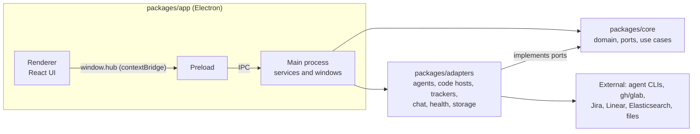

# Architecture

For contributors. For setup and pull request rules see [CONTRIBUTING.md](../CONTRIBUTING.md); the
original scope and decisions are in [PLAN.md](../PLAN.md).

## Packages

An npm workspace with three packages. Dependencies point inward.

| Package | Role | May depend on |
|---|---|---|
| `packages/core` | Domain models, ports (interfaces), use cases, the config schema. Pure TypeScript; its only runtime dependency is `zod`. No Electron or Node APIs. | nothing in the repo |
| `packages/adapters` | Implementations of the ports on Node and Electron: agents, code hosts, trackers, chat, health, storage, transcript readers. | `core` |
| `packages/app` | The Electron shell: main process, preload bridge and the React renderer (Tailwind and Radix, English and Spanish). | `core`, `adapters` |

Workspace packages ship TypeScript source and the app bundles them with electron-vite, so there is
no separate build step for `core` or `adapters`. `scripts/` holds build, release, icon and install
scripts; `spike/` is a historical spike and is not part of the workspaces.

## Ports and adapters (hexagonal)

`core` declares what the app needs; `adapters` supply it. Add behavior as a port in `core` plus an
adapter, not by reaching into a service from the UI.

| Port (in `core`) | Adapters |
|---|---|
| `AgentRuntime` | `agent-claude-native`, `agent-acp`, `agent-terminal` |
| Transcript readers (fill the common monitor model) | `transcript-claude`, `-kiro`, `-opencode`, `-codex` |
| Code host | `codehost-github` (`gh`), `codehost-gitlab` (`glab`) |
| Ticket tracker | `tracker-jira`, `tracker-linear`, `tracker-demo` |
| Chat source | `chat-slack` (through a Claude account's Slack connector) |
| Health provider | `health-elastic` |
| Config and secrets | `config-json`, `secrets-electron` (Electron `safeStorage`) |
| Other | `pr-events-json`, `git-review`, `token-spend`, `workhub1-import` |

Agents declare their capabilities (app mode, transcript, usage, plan usage, history, hooks, models,
MCP status and control, sub-agents, permission requests, image input, mid-turn input). The UI
derives what to show from them, so adding an agent does not mean touching the screens.

The session monitor is independent of the transport: one common model per session, filled by one
transcript reader per agent. Each reader works from the agent's own files, which are internal and
undocumented, so readers ship with fixture tests and fail soft: missing data hides the field and
never breaks the session.

## IPC and security model

- Every window has `contextIsolation: true`, `nodeIntegration: false` and `sandbox: true`. The
  renderer has no Node. The only bridge is the preload script, which exposes one object,
  `window.hub`, with `contextBridge.exposeInMainWorld`. Its shape is typed in
  `packages/app/src/shared`, shared by main, preload and renderer.
- Main registers IPC handlers through two wrappers. `guardIpc` checks that each message comes from
  the app's own renderer (the built `index.html`, or the dev server origin in a dev run); anything
  else is rejected. `timeIpc` times each handler and logs slow or failing ones, never their
  arguments.
- Windows stay on the app's renderer: navigations and redirects away from it are refused (web links
  go to the default browser through the link service instead), `window.open` is denied and
  `<webview>` never attaches. This keeps a window that rendered untrusted Markdown (a pull request,
  a ticket) from becoming a remote page that still holds `window.hub`.
- Web permissions (camera, microphone, geolocation, notifications and so on) are denied by default;
  only sanitized clipboard writes from the app's own renderer are allowed.
- Secrets are never in `config.json`, only `secretRef` keys that point into `secrets.json`, which is
  encrypted with `safeStorage`. Workhub refuses to store a secret when OS encryption is
  unavailable. GitHub and GitLab access reuses the `gh` and `glab` sign-ins; Slack goes through a
  Claude account's connector. See [SECURITY.md](../SECURITY.md).
- Agents run with their own permission modes and MCP servers and can execute code on the machine.
  The effective permission mode of each session is shown in its header.

## Data folder

The data folder is, in order of precedence: `WORKHUB_DATA_DIR`; `packages/app/.dev-data/` in a
development run (git-ignored, and Electron's own files go in `electron/` inside it); the app's
`userData` folder in a packaged build. **Settings → General → Storage** shows the folder of the
running app.

| Entry | Contents |
|---|---|
| `config.json` | Connections, accounts, profiles, options. Never secrets. |
| `secrets.json` | Tokens, encrypted with `safeStorage`. |
| `logs/` | `main.log` and rotated copies; see [Troubleshooting](troubleshooting.md#logs). |
| State files (`*.json`) | Open sessions, session names and windows, agent options, token spend, usage alerts and budgets (including per-session), API spend ledger, Slack state, automation state, pull request events, health alerts, ticket watch. Written through a small `StateFile` helper. They can hold session titles, repository names and Slack message text, and no credentials. |
| `ai-review/` | Read-only checkouts used by the review loop; its state is in `ai-review-state.json`. |
| `pasted-images/` | Images pasted into prompts. |
| `slack-hook/`, `kiro-usage/` | Support folders for the Slack tracking hook and the Kiro usage probe. |

## How agents run

Each session is one `AgentRuntime` in the main process, managed by the session manager, which also
reads the agent's transcript into the monitor and hands a session between views.

- **Native Claude Agent SDK bridge** (`agent-claude-native`): one bridge process per session
  (`bridge/bridge.mjs`), speaking one JSON object per line each way. The SDK drives Claude Code's
  own `claude` binary, so the user's settings, hooks, skills and MCP servers apply. It gives what
  ACP does not carry: MCP status and control, hooks, models, plan usage, images and joining a turn
  in progress. The bridge runs with Electron's own Node (`ELECTRON_RUN_AS_NODE`), so no Node install
  is needed; `scripts/stage-bridge.mjs` stages it with a locked dependency tree for packaging.
- **ACP** (`agent-acp`): the Agent Client Protocol over stdio (newline-delimited JSON-RPC), one agent
  process per session. Used for Kiro (`kiro-cli acp`), OpenCode (`opencode acp`), Codex (through
  `npx`, with the ACP adapter), Gemini CLI (`gemini --acp`) and Claude over the official ACP adapter
  as an alternative engine. Kiro's and others' extensions are used where they exist.
- **Terminal** (`agent-terminal`): any CLI, or a plain shell, over a PTY with `node-pty` (ConPTY on
  Windows) and xterm.js in the renderer. It backs the **Terminal** and **Shell** views. For Claude
  Code the terminal view runs `claude` with the same session id, so App and Terminal hand the same
  conversation back and forth.

Agent definitions (`builtin-agents.ts` in `core`) are data: id, command, adapter kind, capabilities,
mode semantics (permission levels, personas or none), the env variable of an account's config folder
and the transcript reader. Users can add their own in the config; a custom agent with the same id
replaces the built-in one. Sessions start with the login shell's `PATH`, since an app launched from
the Finder or a desktop launcher inherits a bare one.

## Testing

- Vitest, one project per package (`vitest.config.mts` at the root), all in the Node environment,
  with tests under each package's `test/` folder. `npm test` runs them all.
- `core` tests are pure unit tests. Adapters use fixtures for other tools' files and fake bridges or
  fake processes for runtimes; readers must fail soft. App tests cover the main-process services
  and the pure logic of the renderer.
- `npm run typecheck` runs `tsc` on every package; `npm run build` builds the app. CI runs install,
  typecheck, tests and build on macOS, Windows and Linux for every push to `main` and every pull
  request.
- User-facing text goes through the i18n tables in English and Spanish.
- Smoke tests drive a real app: start it with `--remote-debugging-port=9222` and use
  `packages/app/scripts/drive.mjs` over CDP. `packages/app/scripts/demo-agent.mjs` is a custom ACP
  agent that exercises automations without a model. The `WORKHUB_DEMO_*` environment variables serve
  synthetic tickets, pull requests, Slack, Health and usage data (see the
  [README](../README.md#development)).
